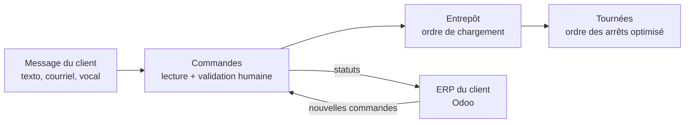
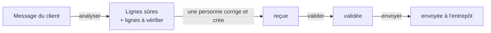

# Relais

Application d'opérations pour la distribution alimentaire. Relais relaie chaque commande du client à l'entrepôt, puis au camion, sans rien perdre en chemin. Elle donne aussi au coordonnateur TI un seul endroit pour gérer le budget, les projets et l'équipement.

**Statut :** en développement. La phase 1 (Commandes) est terminée ; la phase 2 (Tournées) est la prochaine.

## Le problème

| Problème | Aujourd'hui, sans Relais |
|---|---|
| Commandes désordonnées | Les clients commandent par texto, courriel ou message vocal, et quelqu'un retape tout dans l'ERP : c'est lent et il y a des erreurs |
| Tournées inefficaces | Les camions suivent l'ordre des appels : des km en trop et des livraisons urgentes en retard |
| Temps de trajet inconnus | La neige, le trafic et le chargement changent les temps, et personne ne peut les prévoir |
| Procédures perdues | Les employés ne savent pas comment faire et s'interrompent entre eux |
| Passations perdues | Le service à la clientèle, l'entrepôt et la répartition ne savent pas qui fait quoi |
| TI dispersées | Le budget, les projets et l'équipement sont suivis à des endroits différents |

## Ce que Relais va faire

- **Commandes :** lit un message de client et en tire des lignes de commande propres, rapprochées du catalogue. Les lignes floues sont signalées, et une personne confirme avant tout envoi à l'entrepôt.
- **Tournées :** carte interactive de la région de Granby, routes réelles (OSRM) et meilleur ordre des arrêts (OR-Tools), en respectant les compartiments congelé, réfrigéré et sec, les livraisons urgentes et les plages horaires.
- **Prédiction des temps :** un modèle d'apprentissage automatique ajuste les temps selon la météo, l'heure et le chargement. Exemple : « Neige demain : +18 min ».
- **Procédures :** un employé pose une question en mots simples, et Relais répond à partir des procédures écrites en nommant le responsable.
- **Équipe :** chaque tâche et chaque passation, de qui à qui, dans un fil d'équipe en direct.
- **Projets et parc :** budget TI, projets, demandes de l'équipe et état de l'équipement.

## Relais travaille avec les outils en place

Relais ne remplace pas l'ERP ou le CRM du client : il se branche dessus. L'équipe reste dans son outil habituel. Le premier plugin est prévu pour **Odoo**.



## Feuille de route

| Phase | Contenu | Statut |
|---|---|---|
| 1 | Commandes : lecture des messages, validation humaine, statuts | Terminée |
| 2 | Tournées : routes réelles, optimisation, km avant et après | Prochaine |
| 3 | Prédiction des temps : modèle d'apprentissage automatique et météo | À venir |
| 4 | Procédures, Équipe, Projets et parc | À venir |
| 5 | Intégration : plugin Odoo et schéma de branchement | À venir |
| 6 | Interface React : carte, tournées animées, tableau de bord | À venir |

## Ce qui fonctionne aujourd'hui

Le parcours d'une commande, du message du client jusqu'à l'entrepôt :



| Méthode | Route | Rôle |
|---|---|---|
| GET | `/` | Vérifie que l'API est en marche |
| POST | `/commandes/analyser` | Lit le message d'un client : les lignes sûres d'un côté, les lignes à vérifier de l'autre, avec raisons et suggestions. Aucune faute n'est corrigée en silence |
| POST | `/commandes` | Crée une commande d'une ou plusieurs lignes, rapprochées du catalogue (espaces, majuscules et accents tolérés) |
| GET | `/commandes` | Liste les commandes avec leur historique |
| GET | `/commandes/{commande_id}` | Lit une commande |
| POST | `/commandes/{commande_id}/valider` | Une personne confirme ou corrige la commande ; son nom et l'ancienne version restent dans l'historique |
| POST | `/commandes/{commande_id}/envoyer` | Envoie à l'entrepôt une commande validée, jamais avant |

Les messages d'erreur sont en français.

### Exemple : lecture d'un message

> Bonjour! 3 pommes mcintosh, 2 lait 2 % pis du beurre salé. 5 caisses de frites congelées. Merci

| Texte | Résultat |
|---|---|
| 3 pommes mcintosh | Sûr : 3 × Pommes McIntosh |
| 2 lait 2 % | Sûr : 2 × Lait 2 % |
| du beurre salé | À vérifier : produit pas reconnu, quantité manquante. Suggestion : Beurre salé |
| 5 caisses de frites congelées | À vérifier : produit pas reconnu. Suggestion : Frites congelées |

La lecture se fait par règles pour l'instant. Un modèle d'IA pourra la remplacer plus tard, sans retirer la vérification humaine.

## Pile technique

- **Backend :** Python 3.13, FastAPI, Pydantic
- **Tournées :** OSRM, OR-Tools, scikit-learn, Open-Meteo
- **Intégration :** module Odoo (Python)
- **Frontend :** React (Vite) et MapLibre
- **Tests :** pytest

## Lancer le projet

```bash
git clone https://github.com/carewthebeast/relais.git
cd relais/backend
python3.13 -m venv .venv
source .venv/bin/activate
pip install -r requirements.txt
fastapi dev main.py
```

Ouvrez ensuite http://127.0.0.1:8000/docs pour essayer l'API.

Pour lancer les tests automatiques, depuis le dossier `backend/` :

```bash
pytest
```

## Données fictives

Toutes les données sont fictives et identifiées comme telles : distributeur, clients, adresses, employés et procédures. Aucune donnée personnelle réelle n'est utilisée (Loi 25). Le modèle de prédiction des temps sera entraîné sur des trajets simulés.
